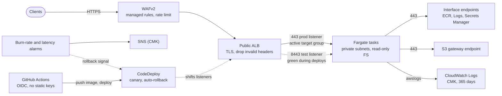

# aws-ecs-fargate-service

A containerised Go API on **Amazon ECS (Fargate)** with **CodeDeploy blue/green**
releases, delivered by GitHub Actions with OIDC into two AWS accounts. The
infrastructure is Terraform with a reusable module, and every release has
automatic rollback driven by the same alarms that page on-call.

Built as a reference for how I would run a small, production-facing service on AWS: the
boring parts are done properly, and each non-obvious choice has an ADR.

> **Status:** the code, infrastructure and pipelines are complete and verified
> offline (see [Verification](#verification)). The repository has not been applied
> to a live AWS account. Account IDs (`111111111111`, `222222222222`), the ACM
> certificate ARNs and the `acme-demo.dev` domain are placeholders.

## The problem

A team needs an HTTP API that:

- serves reads publicly and protects writes with a credential;
- stays within an availability SLO of 99.9% and a p99 latency of 1 s;
- releases without downtime, and rolls back a bad release without a human in the loop;
- runs in two accounts (staging and prod) with separate blast radius, separate state and no shared credentials;
- costs little while it is small, and does not depend on node management.

## Architecture



Full diagrams (network, request flow, deployment flow) are in
[docs/architecture.md](docs/architecture.md).

## Features and design rationale

| Feature | Implementation | Why |
|---------|----------------|-----|
| Fargate runtime | ECS service, awsvpc, no nodes | No cluster upgrades or node patching for one service. [ADR 0001](docs/adr/0001-fargate-over-eks.md) |
| Blue/green releases | CodeDeploy `CODE_DEPLOY` controller, blue and green target groups, test listener on 8443 | Instant rollback and a place to verify before users see the change. [ADR 0002](docs/adr/0002-codedeploy-blue-green-over-rolling.md) |
| Canary in prod | `CodeDeployDefault.ECSCanary10Percent5Minutes`; staging uses all-at-once | Limits blast radius to about 10% for five minutes |
| Automatic rollback | `auto_rollback_configuration` on failure and on alarm | The rollback signal is the same alarm that pages on-call |
| Fargate Spot mix | Staging: on-demand base of 1 plus Spot weight 4. Prod: base of 2 on-demand plus Spot weight 1 | Cost where interruption is tolerable, a floor where it is not. [ADR 0003](docs/adr/0003-fargate-spot-strategy.md) |
| No NAT | Interface endpoints for ECR (api and dkr), Logs and Secrets Manager, plus S3 gateway | No internet route from tasks, and lower data-processing cost. [ADR 0004](docs/adr/0004-vpc-endpoints-over-nat.md) |
| Least-privilege IAM | Separate execution role (pull, log, read named secrets) and task role (empty by default). Secret ARNs are scoped by name | The application itself holds no AWS permissions |
| Secrets | Secrets Manager container created by Terraform, value set out-of-band, injected with `secrets` | The value never enters Terraform state or the task definition |
| Read-only root filesystem | `readonlyRootFilesystem: true`, UID 65532 | A compromised process cannot persist a payload |
| Health checks | ALB checks `/readyz`. ECS container check runs `api healthcheck` | The distroless image has no shell or curl, so the binary probes itself |
| Graceful shutdown | SIGTERM turns readiness off, waits `READY_DRAIN_DELAY`, drains within `SHUTDOWN_TIMEOUT`. `stopTimeout` is 30 s | Spot reclaims and deployments do not drop in-flight requests |
| Autoscaling | Target tracking on CPU (60%) and on requests per healthy host across both target groups | A plain `ALBRequestCountPerTarget` policy follows one group, and that group changes on each release |
| Alarms | Fast and slow 5xx burn rate, p99 latency, unhealthy hosts, SNS on a CMK | Thresholds come from the SLO arithmetic in [docs/slo.md](docs/slo.md) |
| Dashboard | Traffic, error ratio against budget, latency, targets per group, Container Insights, alarm state | One page answers "is this a service problem?" |
| Edge security | WAFv2 with Common, KnownBadInputs, AnonymousIpList, IpReputation and SQLi managed groups, plus a per-IP rate limit. WAF logs redact `Authorization` | Managed rules are maintained by AWS as CVEs appear |
| Network controls | Empty default SG and NACL, VPC flow logs (ALL, CMK), S3 TLS-only policy | Nothing relies on defaults, and traffic is auditable |
| Observability | JSON logs with request IDs and route patterns, Prometheus metrics on a separate port, Container Insights (enhanced) | Logs and metrics stay queryable without high cardinality |
| Provider guard | `allowed_account_ids` on each root | A staging apply cannot touch prod, and the reverse |
| CI identity | GitHub OIDC to IAM roles, no access keys | Nothing long-lived to leak |
| Promotion | The image is built and scanned once, and the same tarball is pushed to each account | What was scanned is what ships |

## Repository layout

```
.
├── app/                         Go service (items API)
│   ├── cmd/api/                 entrypoint: run, healthcheck subcommand
│   ├── internal/app/            lifecycle: servers, drain, probe
│   ├── internal/config/         env parsing and validation (fail fast)
│   ├── internal/items/          domain, validation, repository port
│   ├── internal/metrics/        Prometheus collectors
│   ├── internal/server/         routes, middleware, handlers, envelope
│   ├── scripts/coverage-gate.sh race tests and the 80% coverage gate
│   ├── Dockerfile               multi-stage, distroless nonroot, pinned digests
│   └── .golangci.yml
├── deploy/
│   ├── render-taskdef.sh        live task definition to new revision and AppSpec
│   ├── appspec.yaml.tpl         CodeDeploy ECS AppSpec template
│   ├── smoke-test.sh            post-deploy checks against the public endpoint
│   └── test/render_test.sh      offline tests for the renderer (fixture, no AWS)
├── terraform/
│   ├── modules/
│   │   ├── network/             VPC (community module), endpoints, flow logs
│   │   ├── platform/            CMK, immutable ECR, ECS cluster, capacity providers
│   │   ├── edge/                ALB, WAF, access-log bucket
│   │   └── ecs-service/         task def, service, listeners, CodeDeploy, autoscaling, alarms, dashboard
│   └── envs/
│       ├── staging/             composition, backend.hcl, staging.tfvars
│       └── prod/                composition, backend.hcl, prod.tfvars
├── docs/
│   ├── architecture.md          Mermaid: network, request flow, deployment flow
│   ├── slo.md                   SLOs, burn-rate arithmetic, error budget policy
│   ├── adr/                     four MADR decision records
│   └── runbooks/                rollback, 5xx spike, stuck provisioning, secret rotation
├── .github/
│   ├── workflows/app.yml        lint, test, scan, SBOM, promote, canary deploy
│   ├── workflows/terraform.yml  calls the shared IaC workflow for both environments
│   ├── dependabot.yml, CODEOWNERS, pull_request_template.md
├── Makefile                     make help, make check
├── .checkov.yaml, .tflint.hcl, .pre-commit-config.yaml, .editorconfig
└── LICENSE (MIT)
```

## Run it locally

```bash
cd app
go test -race -cover ./...           # unit tests
APP_ENV=local go run ./cmd/api       # listens on :8080, metrics on :9090

curl -s localhost:8080/api/v1/items
curl -s -X POST localhost:8080/api/v1/items -H 'Content-Type: application/json' -d '{"name":"lamp"}'
```

Configuration is environment-only: `HTTP_PORT`, `METRICS_PORT`, `LOG_LEVEL`,
`SHUTDOWN_TIMEOUT`, `READY_DRAIN_DELAY`, `MAX_PAGE_SIZE`, `API_TOKEN`, and
`APP_ENV`. In `APP_ENV=prod`, `API_TOKEN` is required (at least 16 characters),
and the process refuses to start without it.

API surface:

| Method | Path | Auth | Notes |
|--------|------|------|-------|
| GET | `/healthz` | none | Liveness |
| GET | `/readyz` | none | 503 while draining |
| GET | `/api/v1/items?limit=&offset=` | none | Paginated, `limit` capped by `MAX_PAGE_SIZE` |
| GET | `/api/v1/items/{id}` | none | 404 when missing |
| POST | `/api/v1/items` | bearer token | 201 with `Location`, 422 on validation, 413 over 64 KiB |

Responses use one envelope: `{"data": ..., "meta": ...}` on success and
`{"error": {"code", "message", "request_id"}}` on failure. Server-side errors are
logged with the request ID, and the client gets a generic message.

Storage is an in-memory repository behind an interface. It is deliberate: the
interesting part of this repository is the platform, and the repository port is
where a durable store would plug in.

## How to deploy

### Prerequisites

- Two AWS accounts (staging and prod) with a state bucket in each, named `acme-tfstate-<account>`, versioned and encrypted. The lock file (`use_lockfile = true`) needs no DynamoDB table.
- An ACM certificate in `us-east-1` for the public hostname, in each account.
- IAM roles for GitHub OIDC, one per account, trusted only for this repository and the `staging` and `prod` environments.
- GitHub repository settings:
  - Variables: `AWS_ROLE_ARN_STAGING`, `AWS_ROLE_ARN_PROD`, `STAGING_BASE_URL`, `PROD_BASE_URL`.
  - Environments `staging` and `prod`. `prod` has required reviewers. This is the manual approval gate.

### First-time bootstrap (order matters)

1. Replace the placeholders: account IDs in `envs/*/backend.hcl` and `envs/*/*.tfvars`, the certificate ARN, and the domain. Real alarm email addresses go into a `*.private.tfvars` file, which is git-ignored.
2. Apply the environment. The service is created with the `bootstrap` image tag, which does not exist yet, so the first tasks wait for it.

   ```bash
   terraform -chdir=terraform/envs/staging init -backend-config=backend.hcl
   terraform -chdir=terraform/envs/staging apply -var-file=staging.tfvars
   ```

3. Set the API token value. The task fails to start without it, because the secret has no value.

   ```bash
   umask 077 && openssl rand -base64 32 | tr -d '\n' > "$HOME/token.txt"
   aws secretsmanager put-secret-value --secret-id items-api-staging/api-token \
     --secret-string "file://$HOME/token.txt" && rm -f "$HOME/token.txt"
   ```

4. Push the bootstrap image, which unblocks the first tasks.

   ```bash
   make bootstrap-image ECR_REPOSITORY_URL=111111111111.dkr.ecr.us-east-1.amazonaws.com/items-api
   ```

5. Repeat for prod with the prod account.

Terraform's `allowed_account_ids` guard refuses to run against the wrong account, so
a mistyped profile fails before any change is made.

### Every release after that

Merge to `main`. The pipeline does the rest (next section). To change
infrastructure, open a PR and read the plan that the reusable Terraform workflow
posts to it.

## Pipeline

### `app.yml`: application

| Stage | Runs on | What it proves |
|-------|---------|----------------|
| `lint` (golangci-lint v2.15.0) | every PR touching `app/` or `deploy/` | Static analysis: errcheck, gosec, noctx, staticcheck, gocritic, and others |
| `test` (`coverage-gate.sh`) | every PR | Race-enabled tests with a coverage floor of 80% |
| `hadolint` | every PR | Dockerfile best practice; warnings fail the job |
| `image` | every PR | The image builds, Trivy finds no fixable CRITICAL or HIGH vulnerability or secret, and an SPDX SBOM is produced |
| `deploy-staging` | push to `main` with `AWS_ROLE_ARN_STAGING` set | Pushes the scanned image to staging ECR, renders the task definition, runs a CodeDeploy deployment, waits for stability, and smoke-tests |
| `deploy-prod` | after staging, with `prod` approval | The same, pushed to prod ECR. CodeDeploy runs the canary, and alarms decide whether it continues |

Without AWS variables, `image` is the last job and the workflow is green. The
deploy jobs are skipped, not failed.

Two details matter:

- **The artifact is promoted, not rebuilt.** The `image` job saves the image as a tarball. Each deploy job loads that tarball and pushes it, so the bytes that were scanned are the bytes that run.
- **The task definition comes from the live service.** `deploy/render-taskdef.sh` reads the running revision from ECS, then changes only the image and `SERVICE_VERSION`. Secrets, roles and sizing stay as Terraform defined them.

### `terraform.yml`: infrastructure

Calls the shared reusable workflow `adrianabelgarcia/aws-iac-foundations/.github/workflows/terraform.yml@v1`
for `staging` and then `prod`. On a PR it plans. On push to `main` it applies.
When the role ARN variable is empty it runs only static checks (fmt, validate,
tflint with the repo ruleset, checkov hard-fail), so the workflow stays green
on forks.

## Cost estimate

Approximate monthly cost at list prices in `us-east-1`, assuming 730 hours per
month and low traffic. These are estimates for design discussion. Check them with
the AWS Pricing Calculator before committing a budget.

| Component | Staging (2 AZ, 2 tasks) | Prod (3 AZ, 3 tasks) |
|-----------|-------------------------|----------------------|
| Fargate compute (0.25 vCPU / 0.5 GB staging, 0.5 vCPU / 1 GB prod) | ~$12 (one on-demand, one Spot) | ~$41 (two on-demand, one Spot) |
| Application Load Balancer | ~$22 | ~$25 |
| AWS WAF (web ACL, six rules, five managed groups) | ~$16 | ~$16 |
| Interface VPC endpoints (4 services) | ~$58 (8 endpoint-AZs) | ~$88 (12 endpoint-AZs) |
| S3 gateway endpoint | $0 | $0 |
| CloudWatch (logs, flow logs, alarms, dashboard, enhanced Container Insights) | ~$10 | ~$15 |
| KMS CMK, Secrets Manager secret, ECR storage | ~$3 | ~$3 |
| **Total, before data transfer and tax** | **~$121** | **~$188** |

Two observations. The interface endpoints are the largest fixed line item, and
that is the price of having no NAT path ([ADR 0004](docs/adr/0004-vpc-endpoints-over-nat.md)).
At list prices, the prod Spot mix costs about a quarter less than running the same three tasks on-demand (about $41 against $54).

## Security posture

- **Edge:** TLS 1.2 minimum with a TLS 1.3 preferred policy, HTTP redirects only, invalid header fields dropped, desync mitigation `strictest`, WAF managed rules and a per-IP rate limit, WAF logs with `Authorization` redacted.
- **Network:** tasks have no public IP and no internet route. Security groups reference each other rather than CIDRs. The default SG and NACL are emptied. Flow logs capture all traffic.
- **Identity:** the task role has no permissions by default. The execution role can read only its own secrets, pull only its own repository, and decrypt secrets only through Secrets Manager. CI uses OIDC with no access keys.
- **Application:** distroless image, nonroot UID 65532, read-only root filesystem, no shell. Writes require a bearer token compared in constant time over SHA-256 digests. Security headers on every response. Recovery middleware. Errors leave the server without internal detail.
- **Data:** every log group, the alarm topic, ECR and Secrets Manager use a customer-managed KMS key with rotation enabled. S3 access logs are TLS-only.
- **Supply chain:** Terraform providers and the VPC module are pinned, and lock files cover linux and darwin. Base images are pinned by digest. Dependabot covers Go, Docker, Actions and Terraform. Trivy and an SBOM run on every image.
- **Change control:** CODEOWNERS on infrastructure, pipelines and docs. Prod requires reviewer approval. Terraform refuses to run in the wrong account.
- **Accepted risks, documented:** access-log buckets use SSE-S3 because ALB log delivery does not support KMS. Secret rotation is a runbook, not a Lambda (see [secret rotation](docs/runbooks/secret-rotation.md)). Each skipped Checkov check has an inline justification at the resource.

## Operations

- SLOs and burn-rate alarms: [docs/slo.md](docs/slo.md)
- Runbooks: [docs/runbooks](docs/runbooks/README.md) for rollback, 5xx spikes, tasks that will not start, and secret rotation
- Decisions: [docs/adr](docs/adr/README.md)

## Verification

Checked locally, without AWS credentials:

| Check | Result |
|-------|--------|
| `go vet ./...` | clean |
| `golangci-lint run` (v2.15.0) | 0 issues |
| `go test -race -cover ./...` | all packages pass; total statement coverage 96.7% (gate: 80%) |
| `docker build` (Go 1.27.4, distroless nonroot by digest) | succeeds; image runs as UID 65532 with a read-only root filesystem |
| Trivy image scan (`--severity CRITICAL,HIGH --ignore-unfixed`) | 0 findings. An earlier build on Go 1.24.4 failed on 26 stdlib CVEs, which the toolchain upgrade resolved |
| Container behaviour | `api healthcheck` passes; `/readyz` 200; anonymous `POST` 401; bearer `POST` 201; `/metrics` 200 on the metrics port; SIGTERM drains and exits 0 |
| `hadolint app/Dockerfile` | clean |
| `actionlint` on both workflows | clean |
| `deploy/test/render_test.sh` | 10 of 10 pass (fixture-driven, no AWS calls) |
| `terraform fmt -check -recursive` | clean |
| `terraform validate` (staging, prod) | valid |
| `tflint --recursive` (staging, prod, and each module) | clean with the AWS ruleset 0.45.0 |
| `checkov -d terraform` | 0 failed, 272 passed, 20 skipped (each skip is justified inline) |
| Provider locks | `.terraform.lock.hcl` for `linux_amd64` and `darwin_arm64` |

Not verified here, by design or by environment:

- `terraform plan` or `apply` against AWS. No credentials were used, and nothing was applied.
- The shared reusable workflow in `aws-iac-foundations`, which lives in another repository.
- A live GitHub Actions run. The workflows were linted statically.
- ACM validation, Route 53 records and the end-to-end canary against a real ALB.

## What I would do next

- **Two-token overlap for rotation.** Accept `API_TOKEN` and `API_TOKEN_PREVIOUS` for a window, so a rotation needs no simultaneous client change. The current runbook needs one deployment and a coordinated switch.
- **Lambda lifecycle hooks.** An `AfterAllowTestTraffic` hook would run a richer synthetic test against the green target group before any user traffic moves.
- **ARM64 builds.** Graviton tasks are about 20% cheaper on Fargate. The Dockerfile targets amd64 today.
- **Durable storage.** Replace the in-memory repository with DynamoDB or Aurora behind the existing port, with a migration path.
- **Tracing.** Add OpenTelemetry with the ADOT collector as a sidecar, and correlate the request ID with trace IDs.
- **Pin actions by commit SHA** and let Dependabot propose updates, instead of major-version tags.
- **Per-target-group alarms** driven from the deployment, once CodeDeploy exposes a supported way to recreate them per release.
- **Fault injection.** Use AWS FIS to terminate Spot tasks and fail an AZ in staging, and check the runbooks against the result.
- **Route 53 and ACM in the module.** DNS validation and the alias record are optional inputs today.
- **Multi-region.** The current design is single-region. A second region changes the SLO target and needs its own ADR.

## License

MIT. See [LICENSE](LICENSE).
