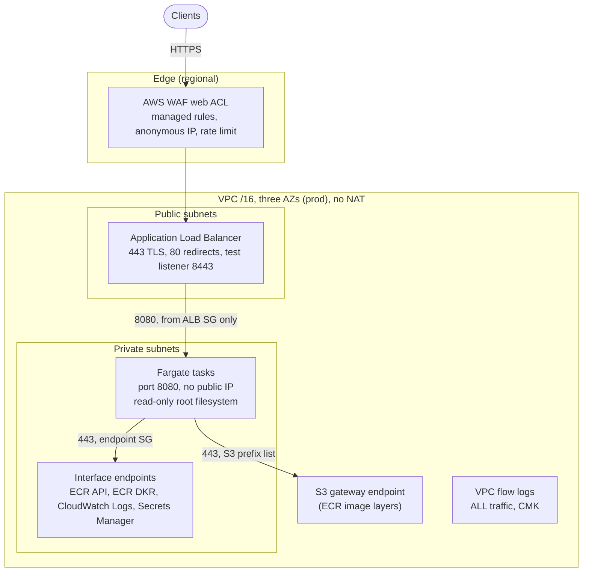
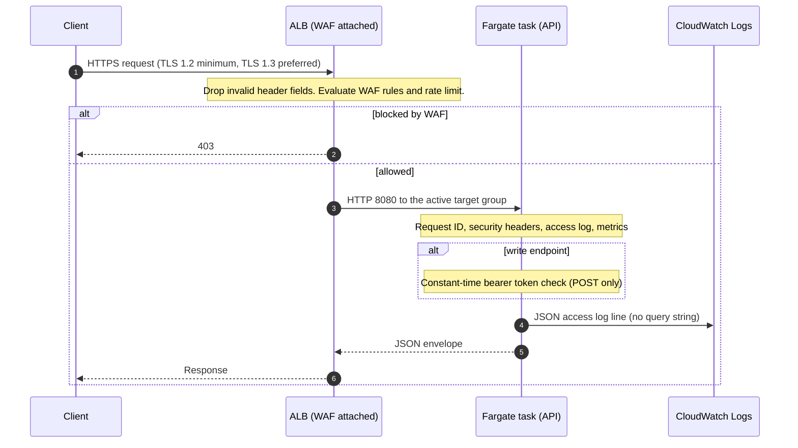
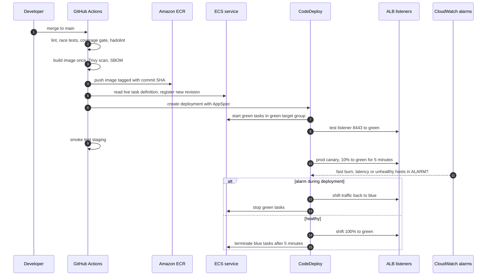
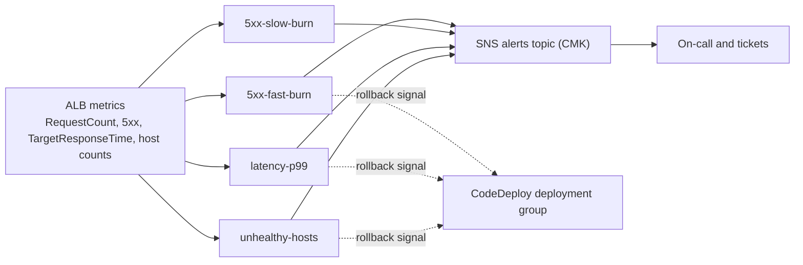

# Architecture

This document shows the three views a reviewer usually asks for: where the
traffic goes (network), what happens to one request (request flow), and how a
release reaches users (deployment flow). Decisions behind each view are in
[docs/adr](adr/README.md).

## 1. Network

Traffic enters through an internet-facing ALB in public subnets. Fargate tasks
run in private subnets with no internet route. They reach AWS services through
interface endpoints and an S3 gateway endpoint (see [ADR 0004](adr/0004-vpc-endpoints-over-nat.md)).

Security groups in one line each:

- **ALB SG:** in 443 and 80 from the internet, in 8443 only from allowed CIDRs (empty by default). Out to the VPC CIDR on the container port.
- **Task SG:** in 8080 from the ALB SG only. Out to the endpoint SG on 443, the S3 prefix list on 443, and the VPC resolver on 53.
- **Endpoint SG:** in 443 from the VPC CIDR only.
- **Default SG and default NACL:** emptied. Nothing uses them.

## 2. Request flow

A `GET /api/v1/items` request, and a write that requires the bearer token.

Operational notes:

- The ALB only forwards to the target group the production listener points at. During a deployment that is blue or green, depending on the phase.
- The access log line carries `route` as the ServeMux pattern (for example `GET /api/v1/items/{id}`), so log and metric cardinality stays bounded.
- Readiness (`/readyz`) returns 503 during shutdown, so the ALB stops sending new requests before the task exits.

## 3. Deployment flow

Each release is a CodeDeploy blue/green deployment. Staging moves all traffic at
once. Prod canaries 10% for five minutes and then shifts the rest. Alarms stop
and roll back either path (see [ADR 0002](adr/0002-codedeploy-blue-green-over-rolling.md)).

Two details that reviewers ask about:

- **Why the pipeline registers the task definition itself.** CodeDeploy needs a concrete revision in the AppSpec. `deploy/render-taskdef.sh` starts from the live revision, so secrets, roles and sizing from Terraform carry through. Only the image and `SERVICE_VERSION` change.
- **Why Terraform does not undo a release.** The service ignores `task_definition`, `load_balancer` and `desired_count` in its lifecycle block, so `terraform apply` never reverts a traffic shift or a revision.

## 4. Alarm and release control

Thresholds and their derivation are in the [SLO document](slo.md).

## Related

- [Runbooks](runbooks/README.md)
- [ADRs](adr/README.md)
